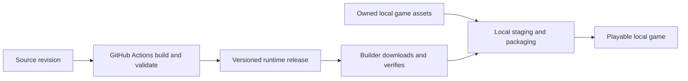

# PLAN-024 Prebuilt Game Runtimes for the Automated Build Tool

Date: 2026-10-10
Status: Steps 1 and 2 implemented; hosted native builds and first release pending

## Purpose

Build the Zero Hour engine and its runtime dependencies once in GitHub Actions.
Let the Automated Build Tool download that runtime and combine it with the
user's owned game assets locally. Keep source builds available for development
and custom engine configurations.

The first version removes the C++ engine and dependency build. It retains local
asset compression and the current Go SFX launcher build. A subsequent packaging
change can remove the remaining compiler requirement. Neither version uploads
retail assets to GitHub.



## Existing integration points

| Component | Current behavior | Required change |
|---|---|---|
| `internal/buildcli/main.go` | Always prepares Git, source, submodules, and a build toolchain | Select source or prebuilt mode before source/toolchain setup |
| `internal/buildcli/download.go` | Downloads with optional SHA-256 verification and safely stages archive extraction | Require a digest for runtimes; add release selection, compatibility checks, bounded downloads/extraction, and cache identity |
| `internal/buildcli/pipeline.go` | Calls platform SFX scripts with the local checkout | Add a runtime input independent of a CMake build tree |
| `scripts/build/linux/bundle-linux-zh.sh` | Produces a portable runtime without retail assets | Reuse its dependency closure and validation in CI |
| `scripts/build/macos/bundle-macos-zh.sh` | Produces a portable app without retail assets | Produce a validated runtime input; fail publication on unresolved dependencies |
| `scripts/build/windows/build-sfx-windows-zh.ps1` | Builds an x86 engine, finds DLLs, stages retail data, and packs SFX | Separate CI runtime collection from local retail staging |
| `scripts/tooling/sfx/cmd/generalsx-sfx-pack/main.go` | Compresses assets, embeds them, then invokes `go build` | Reuse initially with a matching packaging kit; change payload storage for compiler-free packaging later |
| `tools/generalsx-build-desktop/request.go` and frontend | Mirror the source-build flags | Add mode/version selection, validation, review details, and download progress |

`--skip-game-build` is not the new mode. Linux still collects or validates a
bundle, macOS regenerates its bundle, and Windows expects a build directory and
Visual Studio tools such as `dumpbin`. The Go orchestration also bootstraps the
full toolchain before reaching those switches.

## User experience

Add a build method choice:

- **Download prebuilt game**: choose a published compatible version, then use
  existing retail assets or the existing local SteamCMD acquisition flow.
- **Build from source**: retain the current checkout, source ref, toolchain,
  compilation, and customization controls.

Recommend prebuilt mode in the desktop tool once a validated release exists for
the selected target. Preserve the current CLI default during rollout so existing
scripts continue to build their requested source. Implemented CLI syntax:

```text
generalsx-build --build-mode prebuilt --runtime-version stable --assets-dir PATH
generalsx-build --build-mode prebuilt --runtime-version runtime-vX.Y.Z --assets-dir PATH
generalsx-build --build-mode source --repo PATH
```

In prebuilt mode, resolve `stable` once at build start to an exact version and
digest and report that selection in progress/logs and the output receipt. Review
shows the requested publisher and selector before the build starts. Source
checkout/ref controls are hidden; explicitly supplied conflicting CLI options
are rejected. Local code changes only affect source mode. A missing or
incompatible runtime produces an actionable error and a source-mode option;
it never silently installs compilers or starts a full build.

Progress becomes resolve, download, verify, prepare assets, assemble, package,
and verify output. Cached packages skip the download after verification.
Cancellation and failures leave the original assets and previous output intact.

## Runtime packages

Publish complete runtime archives, including the game executable, required
redistributable libraries, launch configuration, project-owned overlays, and
license notices. Do not distribute object files, an entire build tree, retail
archives, user profiles, Steam credentials, or a locally generated SFX payload.

Use separate fields for the engine, packaging host, and launcher architecture:

| Target | Engine | Initial packaging host | Important requirement |
|---|---|---|---|
| Linux | x86_64 | Linux x86_64; macOS Docker builds remain source mode only | Portable ELF dependency closure, host Vulkan driver, measured libc requirements |
| macOS | arm64 | macOS arm64 | Current deployment target is macOS 15.0; relocatable dylibs and MoltenVK configuration |
| Windows exploratory | x86 | Windows amd64 | x86 engine/DLLs inside the amd64 SFX launcher |

Linux and macOS remain the primary delivery targets. The existing Windows
builder now has a native engine CI lane; downloading a build does not change
its exploratory support status.

The Windows runtime must exclude retail `binkw32.dll` and `mss32.dll`, obtaining
the actual x86 DLLs from the user's local installation. Generated link stubs
must never enter a playable package. Bundle only approved redistributable
dependencies and preserve their notices and applicable source distribution
requirements.

Use a versioned external manifest with archive name, size, SHA-256, repository,
full engine commit, dependency revisions, build flags/preset, engine architecture,
launcher architecture, OS requirements, Online compatibility generation,
compiled endpoint, and packaging schema/version. Schema 1 requires the new
prebuilt-capable builder and contains the matching kit inside the same archive,
binding both to one digest. The descriptor's file manifest records paths,
hashes, modes, and permitted symlinks.
The external digest covers the final archive, avoiding a self-referential hash.

The current Linux bundler permits required GLIBC symbols up to 2.38. This is a
policy ceiling, not proof of a minimum supported distribution. Record measured
requirements and test the supported baseline. Do not bundle the user's GPU
driver. On macOS, verify all non-system libraries resolve inside the package
after relocation, without depending on the runner's Homebrew or SDK paths.

## GitHub build and publication

Add a dedicated runtime workflow using the existing platform build commands.
Build changes on the integration branch for CI feedback; publish stable runtimes
from version tags and optionally publish explicit preview versions. Pull
requests may produce temporary test artifacts but cannot publish trusted
runtimes. Cache compiler/dependency work in CI using keys that include the
toolchain, target, dependency revisions, and relevant configuration.

The existing CI/release path produces Linux Flatpak and macOS app outputs.
Flatpak depends on its runtime and must not be unpacked and presented as a
standalone engine bundle. Reuse `bundle-linux-zh.sh` for the portable Linux
package instead of the older inline collection in `build-linux.yml`.
`build-windows.yml` currently tests the Go launcher; add a native `win32-vcpkg`
Release engine build before advertising downloadable Windows engines.

Separate runtime releases from Automated Build Tool releases, for example with
`runtime-vX.Y.Z` tags and `generalsxzh-runtime-VERSION-TARGET` archive names.
Use a runtime-specific index/selection rule; the repository's generic latest
release could refer to the builder or another distribution format. Resolve the
publishing repository explicitly, initially `moloch--/Generals`, and bind it in
the manifest rather than deriving download URLs from arbitrary source remotes.

Publish through a draft release after every advertised target, manifest, and
checksum passes validation. Reuse the exact source/tag checks, pinned actions,
and expected-asset verification patterns in
`.github/workflows/release-automated-build-tool.yml`. Promote the stable selector
only after the complete asset set is available. Versioned artifacts are never
overwritten; a rebuild receives a new package revision. Record resolved
dependency SHAs, including DXVK, rather than treating a branch name as identity.

Use GitHub Release assets for normal downloads. Public release assets support
unauthenticated retrieval, whereas the documented workflow artifact download
flow requires sign-in/read access and artifacts expire. Private distribution
would need an explicit authentication design; it is outside the initial public
download path. See [GitHub release asset API](https://docs.github.com/en/rest/releases/assets)
and [workflow artifact downloads](https://docs.github.com/en/actions/how-tos/manage-workflow-runs/download-workflow-artifacts).

## Local assembly

1. Resolve a runtime matching the target, builder version, requested release,
   and feature requirements. Check manifest schema and platform requirements.
2. Download over HTTPS into a temporary file and require its expected SHA-256
   before extraction or execution. Restrict release metadata to the configured
   publisher; reject malformed metadata, unbounded archives, path escapes,
   conflicting paths, and unsafe symlinks. A checksum validates content against
   trusted release metadata; it is not an independent publisher signature.
3. Cache the verified archive by repository, release identity, target, and
   digest. Revalidate cached content before reuse. Allow an explicitly selected
   cached release offline; do not claim it is the current stable version.
4. Validate owned assets using the current rules and acquire missing assets
   through local SteamCMD only when requested. Create private staging outside
   the asset tree and leave the originals unchanged.
5. Merge assets and the runtime using a fixed, versioned overlay policy.
   Runtime executables/libraries/configuration are authoritative at their
   reserved paths; required retail DLLs on Windows come from owned assets.
   Reject unrecognized reserved-path collisions. Use overlays from the runtime
   release, never files from an unrelated checkout.
6. Package and verify the result, then publish using same-filesystem renames
   with backups and rollback on failure. The two macOS outputs cannot form a
   single filesystem transaction; restoration failures retain a recovery backup
   and report its path. Keep staging cleanup within the builder's ownership
   rules and preserve the reusable runtime cache.

Move platform dependency collection and relocation into CI. Retain local
integrity, architecture, and platform checks without requiring Visual Studio,
vcpkg, Docker, or Vulkan build SDKs merely to consume a runtime. Native Go
PE/ELF/Mach-O inspection can replace development-tool checks where appropriate.
Preserve native host restrictions until each packaging combination is tested.

## Online settings and reproducibility

Official runtimes should include the standard Online feature set and public
endpoint. The current builder treats `--online-endpoint` as a compile-time
default and rejects it with `--skip-game-build`; prebuilt mode must validate the
requested endpoint against the manifest rather than reuse that rejection.

For the initial version, accept the published default and route changes to the
saved default through source mode. The engine already supports
`-onlineServer [tls://]host[:port]` at launch, so users can override it at runtime.
A later launcher metadata field for validated default arguments can expose
saved endpoint overrides without rebuilding the engine. This does not enable
features absent from the downloaded binary.

An optional Online server needs its own pinned, compatible prebuilt artifact
to keep prebuilt mode free of server compilation. Initially leave bundling it
in source mode, with a clear validation message. Never silently clone and build
the server on the prebuilt path.

Store runtime version/digest, engine commit, dependency identity, and packaging
version in the local build receipt. Do not mix engines or overlays across
releases. Packaging changes must leave gameplay binaries unchanged; runtime
compatibility is established by engine tests, not by package checksums alone.

## Implementation sequence

1. **Runtime production:** extract common platform staging/validation, publish
   versioned runtime packages and manifests, and prove their dependency closure.
2. **Prebuilt engine mode:** add resolver/cache and mode-specific bootstrap in
   the shared Go core; add explicit runtime inputs to packaging and expose the
   same configuration in desktop and CLI. Release a small matching packaging
   kit containing the SFX Go module, exclusion profiles, and required resources
   so this mode need not clone the full repository or initialize submodules.
3. **Compiler-free packaging:** replace compile-time `go:embed` payload storage
   with a versioned payload reader and a precompiled launcher. A macOS app can
   keep a payload in Resources; single-file Windows/Linux launchers require a
   defined appended-payload format with bounds, hashes, and truncation checks.
   Precompile the macOS progress helper and ship a native packer as well.

Step 2 still needs Go and compression support; current macOS app packaging also
compiles a small progress helper with `xcrun clang`. Its bootstrap must report
those remaining needs accurately, or move that helper into CI earlier. Step 3
requires separate signing/layout validation; changing payload bytes cannot be
assumed to preserve a platform signature. A locally assembled app must not be
represented as a CI-notarized final artifact.

Asset staging, hashing, and compression remain local work in every version.
Existing SFX size limits still apply. Measure timings before promising an
overall speedup; eliminating engine compilation does not eliminate multi-GB
asset processing.

## Validation criteria

- Install a compatible runtime on a clean target host without C++, CMake,
  vcpkg, Docker, or graphics build SDKs; document any remaining Go/macOS helper
  tools during step 2. Step 3 must also succeed without Go or a C compiler.
- Verify runtime archives contain no retail payload or generated Windows
  Bink/Miles stubs. CI can test synthetic asset fixtures; full game launch and
  replay tests require a separate environment with owned assets.
- Exercise wrong architecture, unsupported OS/schema, missing release, digest
  mismatch, corrupt cache, traversal, symlink escape, interrupted download,
  cancellation, concurrent cache use, and a failed output replacement.
- Confirm source mode still builds local edits and prebuilt mode never compiles
  the engine, its dependencies, or the optional server. Step 2 permits its
  disclosed packaging builds. Reject incompatible options before host changes
  or runtime downloads.
- Verify local asset hashes are unchanged and the packaged engine hash matches
  the chosen runtime. Run the existing SFX verification and native launch tests.
- Validate relocated runtime dependencies on clean supported OS installations,
  then smoke-test menu entry, audio/video, and the configured Online endpoint.
- Test representative replays and supported multiplayer combinations before
  promoting an engine version. Claim only the platforms actually validated.

## Implementation and validation status (2026-10-10)

- Added the three-platform runtime workflow, normalized exporters, metadata
  collection, strict schema-1 producer/verifier, and immutable draft publication.
- Added CLI and desktop source/prebuilt selection, exact/stable resolution,
  bounded verified caching, CLI offline reuse, private local assembly, native
  packaging and final verification. Source remains the default.
- Exported an actual Windows x86 runtime without retail DLLs. Used its complete
  kit and synthetic owned-asset fixtures to run the real offline assembly and
  Go packer; the generated SFX passed full `--sfx-verify`.
- Tested invalid manifests, binary architectures, unsafe paths, corrupt cache,
  interrupted downloads, concurrent downloads, asset preservation, overlay
  handling, and output rollback. Cross-built Linux/macOS launchers from the
  extracted packaging kit.
- GitHub-hosted native Linux/macOS engine builds, clean-machine gameplay checks,
  and runtime publication have not run in this local implementation session.
  The workflow must pass before advertising available downloads.
- Step 3 (compiler-free packaging) remains a separate payload-format change.
  Go and the macOS progress-helper compiler requirements are explicit in the UI,
  CLI diagnostics, and user guide.

Usage and release instructions are in
`docs/HOWTO/AUTOMATED_SFX_BUILD.md`.
